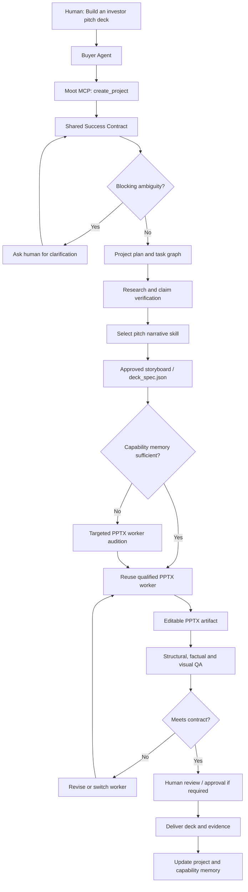

# Moot: Open-Source PPT and Investor Pitch Deck Skills

**Research date:** October 17, 2026  
**Purpose:** Identify practical agent skills and libraries for Moot's multi-agent pitch-deck workflow, with editable PPTX generation, narrative development, review, and automated verification.

> **Important distinction:** A `SKILL.md` is usually an instruction set for an AI agent, not an independently running agent. Moot should wrap each selected skill or toolchain in a worker adapter with a consistent input/output contract. Open GitHub visibility does not always mean an open-source license; verify each repository's current license and dependencies before commercial reuse.

## A. PowerPoint generation and editing skills

| Project | Repository | What it does | Moot role | Notes |
|---|---|---|---|---|
| **pptx-gen** | https://github.com/alfonsograziano/pptx-gen | Agent-driven, editable PPTX generation; clone/fill existing slide templates or design from native shapes; includes `pptx-deck` and template/design skills. | **Primary PPTX generation/editing worker** | Repository documents MIT license; strong candidate for iterative edits. |
| **presentation-skill** | https://github.com/siril9/presentation-skill | Structured presentation generation with source-first workflow and render QA. | Alternative design worker | Inspect implementation, license, and CLI before integrating. |
| **PPTskill** | https://github.com/PoplarPoplar/presentation-skill_-PPTskill | Outline-driven PPTX skill with layout/visual checks. | Alternative worker or evaluation reference | Validate repository and exact output/editability behavior before relying on it. |
| **deckgen** | https://github.com/kingwatam/deckgen | `SKILL.md` + PptxGenJS to turn structured text/research into editable PPTX with speaker notes. | **Simple baseline PPTX worker** | Particularly suited to technical/research decks; inspect license. |
| **SlideSage** | https://github.com/vedraut/slidesage | Separates LLM-created JSON storyboard from deterministic PptxGenJS renderer; business-pitch mode. | **Structured storyboard-to-PPTX worker** | Excellent for fair comparisons: shared storyboard, different renderers. Verify license. |
| **presentation-creator** | https://github.com/mblode/agent-skills/blob/main/skills/presentation-creator/SKILL.md | Story spine, slide sequencing, copy, design system, notes; defaults to Marp/Slidev/reveal.js. | Storyboard and narrative worker | Not necessarily native PPTX without an additional rendering tool. |
| **Anthropic PPTX skill** | https://github.com/anthropics/skills/tree/main/skills/pptx | Reference workflow for creating/editing and checking presentations. | Inspiration / evaluation checklist | **Source-available; do not assume open-source reuse rights.** Check its separate license. |

## B. Pitch deck / fundraising narrative skills

| Project | Repository | What it does | Moot role | Notes |
|---|---|---|---|---|
| **Pitch Deck Advisor** | https://github.com/amaklakov-droid/pitch-deck-skill | Agent skill to create, review, and revise investor decks; stage-specific structure, red-flag checks, deep-tech framing. | **Primary pitch strategy + review worker** | MIT licensed per repository; supports standard `SKILL.md` workflow. |
| **Startup Founder Skills** | https://github.com/shawnpang/startup-founder-skills | Founder-focused skills including `pitch-deck`, fundraising and investor research. | Alternate pitch narrative / investor research worker | Verify license of included skills and source attribution. |
| **Founder Skills (UniqueClub)** | https://github.com/wulaosiji/founder-skills | `pitch-deck-creator` plus investor research; script generates a 10-slide PPTX from JSON using python-pptx. | **Combined narrative + PPTX baseline** | Useful end-to-end benchmark; inspect license and script quality. |
| **Investor Pitch Deck Builder** | https://github.com/maigentic/stratarts/tree/main/skills/fundraising-operations/investor-pitch-deck-builder | Skill for 10–15-slide fundraising narrative, market, traction and ask. | Additional narrative candidate | Verify source and license; never fabricate fundraising metrics. |
| **presentation-creator** | https://github.com/mblode/agent-skills/blob/main/skills/presentation-creator/SKILL.md | Narrative spine, audience-aware density, slide copy and speaker notes. | Cross-over: pitch outline + slide storytelling | Often outputs Markdown/web slides, not PPTX directly. |
| **SlideSage** | https://github.com/vedraut/slidesage | Business storytelling and storyboard schema plus deterministic PPTX renderer. | Cross-over: pitch narrative + PPTX | Good choice if you want one source-of-truth JSON storyboard. |

### Source links checked

- pptx-gen README: https://github.com/alfonsograziano/pptx-gen/blob/master/README.md
- Pitch Deck Advisor: https://github.com/amaklakov-droid/pitch-deck-skill
- Startup Founder Skills: https://github.com/shawnpang/startup-founder-skills
- Founder Skills: https://github.com/wulaosiji/founder-skills
- SlideSage: https://github.com/vedraut/slidesage
- deckgen: https://github.com/kingwatam/deckgen
- presentation-creator: https://github.com/mblode/agent-skills/blob/main/skills/presentation-creator/SKILL.md

## C. Recommended Moot MVP stack

**Narrative:** Pitch Deck Advisor (investor story, section structure, red flags).  
**Slide planning:** SlideSage storyboard schema or Moot's own `deck_spec.json`.  
**PPTX candidates:** pptx-gen and deckgen, optionally Founder Skills as a third candidate.  
**Verification:** PPTX parse/structure checks, required-content checks, citations/claim verification, render-to-image inspection, and human preference review.  
**Orchestration:** Moot MCP server and project/task memory. Primitive adapter for agent-to-agent messaging if supported by the actual API; otherwise direct worker invocation.

### Why this division matters

A pitch advisor skill and a PPTX renderer are not interchangeable candidates. Evaluate **narrative workers against narrative tasks** and **renderers against rendering tasks**. For fair rendering auditions, supply the same approved storyboard and brand specification to each worker. For fair narrative auditions, supply the same factual brief and target investor persona.

## D. End-to-end pitch deck workflow



## E. Proposed MCP API

```json
{
  "tool": "moot.create_project",
  "arguments": {
    "goal": "Create a 5-slide editable investor pitch deck",
    "deliverable": "pptx",
    "audience": "seed_investors",
    "requirements": {
      "source_citations": true,
      "no_invented_metrics": true,
      "editable_elements": true,
      "approval_checkpoints": ["storyboard", "final"]
    },
    "max_budget_usd": 5
  }
}
```

Recommended MCP tools: `moot.create_project`, `moot.get_project`, `moot.clarify_contract`, `moot.evaluate_workers`, `moot.delegate`, `moot.verify_artifact`, and `moot.request_revision`. A simple `moot.delegate` facade can select the correct internal workflow automatically.

## F. Benchmark design

| Test | Automated evidence | Human judgment |
|---|---|---|
| Output validity | PPTX can be opened and parsed | — |
| Editable slides | Inspect native text/shapes; avoid image-only slide decks | Can user meaningfully edit it? |
| Structural compliance | Slide count, required sections, notes | Does sequence make sense? |
| Factual accuracy | Claims traced to supplied documents or verified sources | Are claims presented responsibly? |
| Visual quality | Render slides, check clipping/overflow | Legibility, polish, persuasion |
| Revision fidelity | Compare protected claims before/after edits | Does revision match the request? |
| Cost and latency | Record actual execution cost/time | Acceptable trade-off? |

**Do not** reduce these dimensions to one unsupported score. Treat hard failures (invalid PPTX, fabricated claims) as gating checks. Use human review for subjective investor-readiness.

## G. Hackathon demonstration

1. Buyer Agent asks Moot to produce a **3-slide investor teaser** from a verified brief.
2. Moot creates a shared success contract: investor audience, story, editable PPTX, no invented metrics.
3. Pitch Deck Advisor generates a narrative outline; human approves it once.
4. Moot compares **two actual PPTX workers** on the same storyboard; show measurable output checks and cost.
5. Selected worker produces the real `.pptx` file; Moot validates it and returns an artifact link.
6. Human requests: **“Make slide 2 more visual, but do not change any numbers.”**
7. Moot routes only the revision, verifies that approved claims remain unchanged, and updates shared project/capability memory.

**Suggested MVP order:** working PPTX generation → MCP tool interface → verifiable constraints → revision workflow → worker comparison → Primitive communication integration. This minimizes the risk of a flashy but nonfunctional demo.

## H. Caveats and integration checklist

- Confirm each candidate's current license, dependencies, security posture, and compatibility before incorporating its code.
- Sandbox skill execution; third-party `SKILL.md` files and generated scripts are untrusted inputs.
- Pin repository commits and tool versions for reproducible auditions.
- Keep private investor materials isolated per customer; share only permitted aggregate capability evidence.
- Track provenance and prohibit fabricated market sizes, traction, revenue, or fundraising metrics.
- Do not assume every listed repository implements a standalone MCP server; most need a worker wrapper.
- Primitive's exact discovery/messaging semantics must be checked against its actual SDK documentation before implementation.
