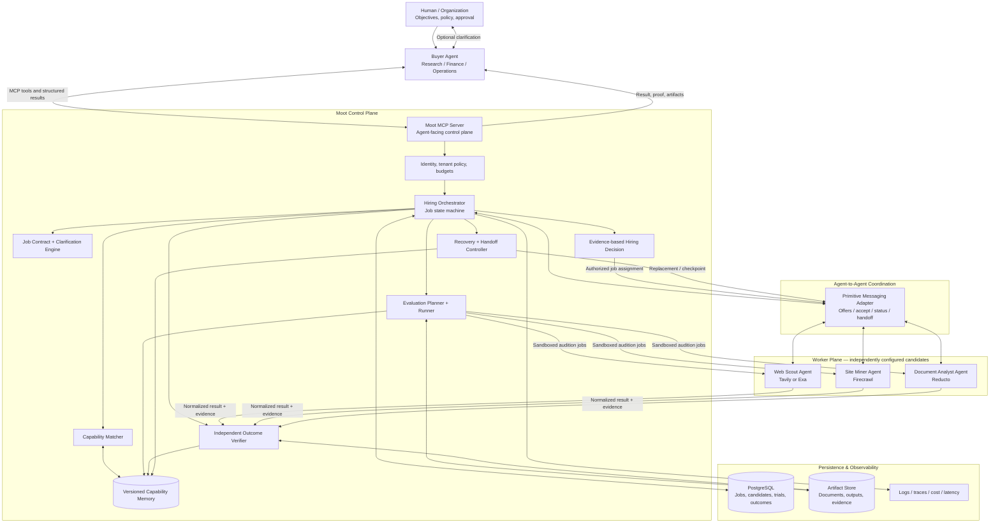
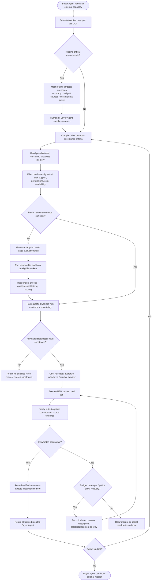
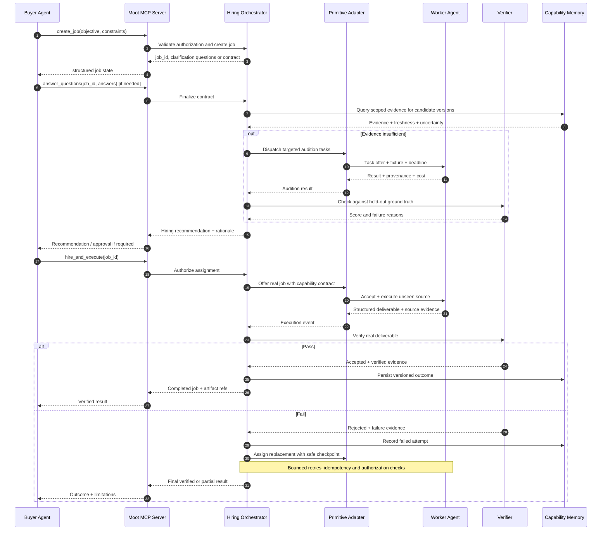

# Moot — Agent-Native Hiring, Evaluation & Verified Delegation

**System design and workflow | Hackathon implementation specification | October 2026**

> **One-liner:** Moot enables autonomous AI agents to discover, evaluate, hire, and verify other agents using job-specific tests and shared evidence of real-world performance.
>
> **Pitch:** Benchmarks tell you how an agent performs on a test. Moot proves which agent can do *your* job—and helps it recover when the hired worker fails.

## 1. Product thesis

Humans want completed outcomes; their agents need dependable external capabilities. A research agent tasked with producing a financial comparison may need specialist extraction workers for websites, annual reports, and complex tables. A static leaderboard cannot answer which worker is suitable for this exact job, under its budget, evidence requirements, and deadline.

**Moot is an agent-native hiring and trust layer**, not a human-first marketplace or a generic model benchmark. A buyer agent submits a machine-readable job contract, Moot uses existing capability evidence and targeted work trials to select a worker, delegates the real task, independently verifies the deliverable, and records the outcome for future hiring. Human clarification is requested only when essential constraints or authorization are missing.

**Hackathon vertical:** website + document extraction. **Platform ambition:** reusable hiring and verified delegation for any machine-callable specialist agent.

### Goals

1. An external **Buyer Agent** can initiate and complete the hiring flow through MCP, without clicking through the UI.
2. Job-specific evaluation tests **fitness for the buyer's actual workflow**, not a generic global rank.
3. Candidates perform **real tool calls**, with fair capability matching and independent checks.
4. A hired worker performs an **unseen production-like task** after the audition.
5. Failed or incomplete work can trigger **verification, alternate-worker selection, and resumable handoff**.
6. Verified outcomes update **permissioned shared capability memory**, reducing unnecessary re-testing on future jobs.
7. The system returns structured evidence, costs, status, and artifacts so the buyer agent can continue its original mission.

### Non-goals for the weekend

Real-money settlement, open public agent onboarding, universal benchmark coverage, long-running orchestration at scale, cryptographic proof of all outcomes, and guaranteed numerical accuracy. Do not claim that LLM confidence alone verifies extracted facts.

## 2. Architectural responsibilities: MCP vs Primitive

| Component | Responsibility | Not responsible for |
|---|---|---|
| **MCP server** | Standardized agent-facing tool discovery and invocation (`create_job`, `evaluate`, `hire`, `get_result`) | Agent-to-agent transport guarantees or truth of evaluation results |
| **Primitive adapter** | Agent-to-agent messaging, request/response coordination, task offers, status notifications and handoff *where supported by its actual SDK/API* | Evaluation scoring, authorization policy, source verification, persistence |
| **Moot orchestrator** | Job state machine, candidate selection, audition scheduling, hiring decisions, recovery | Provider-specific scraping/parsing implementation |
| **Evaluation engine** | Generate applicable probes, run independent checks, compute evidence-backed scores | Trusting self-reported candidate benchmarks |
| **Worker adapters** | Invoke Tavily/Exa, Firecrawl, Reducto and normalize outputs | Claiming those providers are themselves autonomous agents |
| **Capability memory** | Persist versioned, scoped, verified performance records | Sharing customer documents or confidential traces publicly |
| **Verifier** | Validate schema, provenance, ground truth where available, business rules and delivery completeness | Treating JSON validity as factual accuracy |

**Important integration boundary:** Primitive's exact API surface and delivery semantics must be confirmed against the SDK available at the event. The design uses a `PrimitiveMessagingPort` abstraction, not invented Primitive endpoints. If direct Primitive integration is delayed, a local transport implementing the same port can run the demo; label it honestly and do not claim sponsor integration until actual calls are demonstrated.

## 3. System architecture



### Deployment shape (MVP)

- **Frontend:** Next.js conversational demo and live timeline; UI observes backend state and is not the sole way to operate Moot.
- **MCP server:** Python FastMCP or TypeScript MCP SDK exposing tools to a real external agent client.
- **API / orchestrator:** FastAPI or Next.js API service; asynchronous job execution with a queue/background worker.
- **Primitive integration:** dedicated transport adapter for worker discovery/coordination/messages where supported; persist correlation IDs, acknowledgments, and idempotency keys locally.
- **Workers:** independently configured agent wrappers with distinct tools, prompts, permissions, cost profiles and machine-readable capabilities. Provider APIs are tools used *by* workers.
- **Storage:** Postgres for durable state, evaluations and memory; object storage or local files for artifacts in the MVP.
- **Verification:** deterministic JSON Schema checks, fixture ground truth, cited-source checks and explicit abstention rules; optional LLM reviewer only for qualitative checks, clearly separated from objective checks.

## 4. End-to-end workflow



### Swimlane sequence: what calls what



## 5. Job contract, worker registration and evidence model

### 5.1 Buyer job contract (illustrative)

```json
{
  "job_id": "job_123",
  "objective": "Compare revenue and operating income from annual reports",
  "source_types": ["pdf", "web"],
  "required_fields": ["company", "fiscal_year", "revenue", "operating_income"],
  "output_schema_id": "financial_comparison_v1",
  "constraints": {
    "max_total_cost_usd": 0.50,
    "deadline_seconds": 120,
    "missing_field_policy": "null_with_reason",
    "source_citations_required": true,
    "minimum_acceptable_quality": "all_required_fields_supported_or_abstained"
  },
  "workflow": {
    "recurring": true,
    "follow_up_updates_expected": true,
    "allow_reassignment": true
  },
  "authorization": {
    "approved_domains": ["example.com"],
    "human_approval_required_for_external_payment": true
  }
}
```

**Do not equate a `min_accuracy` field with a guaranteed per-document probability.** If a target is supplied, interpret it as an evaluation threshold over an identified test set and report sample size and uncertainty.

### 5.2 Worker capability registration

```json
{
  "worker_id": "worker_document_analyst",
  "version_fingerprint": "model+prompt+tools+permissions+code_hash",
  "supported_inputs": ["pdf"],
  "supported_outputs": ["structured_json", "source_spans"],
  "tool_dependencies": ["reducto"],
  "max_file_mb": 20,
  "pricing": {"unit": "page", "estimate_usd": 0.01},
  "permissions": ["read_uploaded_documents"],
  "endpoint": "registered_worker_transport_address"
}
```

### 5.3 Verified capability memory

Each **evidence record** should contain:

- `worker_id`, immutable `version_fingerprint`, `task_taxonomy`, input modality, complexity and environment;
- evaluation fixture ID or real-job ID, verifier version, test date and freshness;
- field-level pass/fail counts, abstentions, provenance coverage, end-to-end completion, cost and latency;
- confidence interval or uncertainty notes, and known failure modes;
- visibility scope (`public_aggregate`, `tenant_private`, `job_private`) and retention policy;
- artifact references rather than raw sensitive document text in shared memory.

**Memory is evidence, not an unqualified global score.** Compare only task-relevant evidence; weight by freshness, difficulty, sample size, and worker version. A tool/model upgrade invalidates or downweights old results until revalidated.

### 5.4 Three memory layers

| Layer | Scope | Use |
|---|---|---|
| Public / network capability memory | Permissioned aggregates only | Reuse verified performance signals across eligible buyers |
| Buyer-private memory | Tenant-specific | Preferences, budgets, private hiring history, domain restrictions |
| Job / handoff memory | Specific job and authorized workers | Source references, partial artifacts, completed steps, checkpoints, failure causes |

## 6. MCP tool surface

Use a small, stable tool set. Tool results should be machine-readable, include `job_id`, status, errors, cost and evidence references, and support asynchronous polling for long jobs.

| MCP tool | Input | Output |
|---|---|---|
| `moot.create_job` | Objective, sources, constraints | Job ID, questions or normalized contract |
| `moot.answer_questions` | Job ID, structured answers | Updated contract, outstanding requirements |
| `moot.find_candidates` | Job ID | Eligible workers, capability evidence and gaps |
| `moot.run_audition` | Job ID, candidate IDs, limits | Audition run ID / status |
| `moot.get_evaluation` | Run ID | Field-level checks, scores, costs, confidence and rationale |
| `moot.hire_and_execute` | Job ID, selected worker or auto-select, authorization | Execution ID / status |
| `moot.get_job` | Job ID | State, verified output, citations, artifacts, failure reason |
| `moot.get_worker_passport` | Worker ID and version | Scoped capability memory and known limitations |

For a weekend MVP, combine `find_candidates` + `run_audition` behind `moot.evaluate_and_recommend` if needed, but keep the stages distinct internally for auditability.

### Primitive coordination events (logical schema, not asserted SDK method names)

```json
{
  "event_type": "task_offer",
  "message_id": "msg_456",
  "correlation_id": "job_123",
  "sender": "moot-orchestrator",
  "recipient": "worker_document_analyst",
  "payload": {
    "contract_ref": "contract_123",
    "artifact_refs": ["artifact_abc"],
    "deadline_seconds": 120,
    "idempotency_key": "job_123_attempt_1"
  }
}
```

Other logical events: `offer_accepted`, `offer_rejected`, `execution_started`, `execution_progress`, `execution_completed`, `execution_failed`, `handoff_requested`, `handoff_accepted`. Map these onto **documented** Primitive capabilities during integration. Use durable local job state as the source of truth; never assume message delivery is exactly once.

## 7. Evaluation design for the extraction demo

### 7.1 Candidate workers

- **Web Scout:** agent wrapper around Tavily or Exa for discovery and content retrieval.
- **Site Miner:** agent wrapper around Firecrawl for web page crawling and structured extraction.
- **Document Analyst:** agent wrapper around Reducto for PDFs and complex layouts.

**Fairness rule:** do not directly rank a PDF-only candidate against a web-only candidate on unsupported inputs. First filter by modality. For mixed web+PDF jobs, compare **qualified end-to-end worker compositions** or evaluate modality-specific subcontracts separately. Providers are tools, not automatically independent agents.

### 7.2 Evaluation stages

| Stage | Probe | Objective check |
|---|---|---|
| Capability gate | Supported modality, output schema, permission, budget | Eligibility pass/fail |
| Field extraction | Known-source financial fields | Exact/numeric-tolerance match to human-reviewed ground truth |
| Evidence | Source page/URL + location | Citation exists and supports the extracted field where checkable |
| Abstention | Deliberately missing financial field | `null` + explanation, no invented number |
| Multi-step continuity | New report revises earlier value | Correct delta, preserved unaffected fields and provenance |
| Failure handling | Tool error / incomplete response | Bounded retry, explicit failure or safe fallback |
| Efficiency | Same eligible workload | Measured total spend and wall-clock latency |

### 7.3 Scoring and hiring

**Hard gates first:** authorized tools, supported modality, schema, budget cap, critical field correctness, abstention policy. A worker that violates a non-negotiable requirement cannot win solely through low latency.

Illustrative soft score after passing gates:

`score = 0.35 × correctness + 0.20 × evidence/completeness + 0.20 × multi-step reliability + 0.15 × recovery + 0.10 × cost/latency`

Normalize each component on a disclosed scale and report per-component evidence. Adjust weights from job requirements; do not imply statistically reliable precision from a handful of samples. Include the **cost of evaluation itself** in the economics.

**Verifier hierarchy:** deterministic fixtures > independent source-based checks > constrained qualitative review. Distinguish *verified*, *partially verified*, and *unverified* claims in results.

### 7.4 Prevent benchmark gaming

Use separate audition fixtures and unseen post-hire documents, hidden ground truth, limited candidate feedback, stable test harness versions, and versioned worker configurations. Avoid using evaluation outputs as the only source of subsequent ground truth.

## 8. Hiring state machine and recovery

```mermaid
stateDiagram-v2
    [*] --> DRAFT
    DRAFT --> CLARIFICATION_REQUIRED: Missing critical constraints
    CLARIFICATION_REQUIRED --> READY: Answers received
    DRAFT --> READY: Complete job spec
    READY --> EVALUATING
    EVALUATING --> RECOMMENDED: Qualified candidate
    EVALUATING --> NO_MATCH: None qualified
    RECOMMENDED --> AWAITING_APPROVAL: Policy requires approval
    RECOMMENDED --> ASSIGNED: Auto-authorized
    AWAITING_APPROVAL --> ASSIGNED: Approved
    AWAITING_APPROVAL --> CANCELLED: Rejected
    ASSIGNED --> RUNNING
    RUNNING --> VERIFYING
    VERIFYING --> COMPLETED: Verified acceptance
    VERIFYING --> RECOVERING: Failed checks and retry allowed
    RUNNING --> RECOVERING: Timeout or worker failure
    RECOVERING --> ASSIGNED: Replacement / safe retry
    RECOVERING --> FAILED: No viable recovery
    VERIFYING --> PARTIAL: No retry; partial evidence available
    COMPLETED --> [*]
    FAILED --> [*]
    PARTIAL --> [*]
    NO_MATCH --> [*]
    CANCELLED --> [*]
```



**Recovery safeguards:** checkpoint completed artifacts; pass only authorized references to replacement workers; distinguish idempotent reads from side-effecting actions; set max attempts, timeouts, spend caps and cancellation; avoid retrying non-idempotent operations without reconciliation. The extraction MVP is largely read-only, but the protocol must not assume all future jobs are.

## 9. Hackathon demo script (3–4 minutes)

**The story:** A Buyer Research Agent must produce a financial comparison, but it lacks reliable extraction. It uses Moot as a service—not a human manually choosing a winner.

| Time | Live demonstration | What it proves |
|---|---|---|
| 0:00–0:25 | Human gives Buyer Agent an objective; Buyer Agent invokes `moot.create_job` | The agent is the actual customer |
| 0:25–0:50 | Moot asks one or two essential questions only if missing; returns contract | Agent experience and adaptive requirements |
| 0:50–1:25 | Capability memory filters candidates; targeted auditions execute | Job-specific evaluation, not static leaderboard |
| 1:25–1:45 | Explainable hiring decision, source-backed metrics, cost | Verified selection |
| 1:45–2:20 | Hired worker executes a **new unseen** PDF or website task | Real agent-to-agent delegation |
| 2:20–2:50 | Introduce a reproducible missing-field or worker-failure scenario; verifier rejects, Moot safely reassigns | Reliability and autonomous recovery |
| 2:50–3:20 | Replacement completes; Buyer Agent uses result in its final table | Moot enables a larger autonomous workflow |
| 3:20–3:45 | Run a related second job; show memory reused and updated | Every job improves future decisions |

**Demo credibility rules:** all showcased provider calls, worker selection and verification must be real; don't hard-code a winner. Pre-load fixtures and cache *historical evidence* if clearly labeled. A backup recording is acceptable if labeled as such. Ensure the failure scenario is reproducible without secretly substituting fake results.

### Optional alternate-user moment

Show two contracts against the same worker pool: **cheap, fast website extraction** versus **high-accuracy financial PDF tables**. Different evidence and constraints may legitimately produce different winners; never promise a specific winner before executing tests.

## 10. Build plan and scope

### P0 — required for a credible submission

1. MCP server callable by an external Buyer Agent; live tool invocation shown.
2. Persistent job contracts and one or two clarification questions.
3. Two independently configured **eligible** workers on a comparable test workload (third if time permits).
4. At least 3–5 ground-truth fixtures with explicit acceptance checks and held-out real job.
5. Audition report with evidence, failures, total cost and latency.
6. Real hiring decision and execution on an unseen document/site.
7. Versioned capability records saved after verified execution.
8. Primitive adapter wired into at least one real worker communication path **if documented SDK support and credentials are available**.

### P1 — high-impact differentiators

- Multi-stage update task using existing job artifacts.
- One verifiable failure, bounded recovery, replacement and resumed work.
- Second hiring decision reusing evidence from shared memory.
- Live event stream visualizing offers, evaluations, execution and checks.

### P2 — after the hackathon

- Open worker registration and identity attestation.
- Actual payment settlement, escrow and disputes.
- Cross-tenant privacy-preserving reputation aggregation.
- Larger task taxonomy, calibration studies and benchmark suites.
- Enterprise access control, SLAs, monitoring and continuous re-evaluation.

## 11. Suggested code structure

```text
moot/
  apps/web/                     # Next.js hiring timeline + evidence dashboard
  services/mcp-server/          # Agent-facing MCP tools
  services/orchestrator/        # Job contracts, state machine, policy, hiring
  services/evaluator/           # Fixtures, checks, ranking, calibration
  services/verifier/            # Provenance and deliverable validation
  integrations/primitive/       # MessagingPort implementation
  integrations/providers/       # Tavily/Exa, Firecrawl, Reducto clients
  workers/web_scout/            # Candidate agent 1
  workers/site_miner/           # Candidate agent 2
  workers/document_analyst/     # Candidate agent 3
  packages/contracts/           # Pydantic / JSON Schema, event definitions
  packages/memory/              # Evidence retrieval and versioning
  data/fixtures/                # Reviewed evaluation documents + truth
  infra/                        # DB migrations, local compose, deployment
```

### Suggested core database tables

`agents`, `agent_versions`, `jobs`, `job_contracts`, `clarifications`, `candidate_matches`, `evaluation_runs`, `evaluation_checks`, `hiring_decisions`, `assignments`, `execution_attempts`, `artifacts`, `verification_results`, `capability_evidence`, `coordination_events`, `tenant_policies`.

## 12. Security, privacy, and trust

- Authenticate Buyer Agents and workers; authorize every tool invocation by tenant, job and scope.
- Restrict worker access to approved source URLs/documents and least-privilege credentials.
- Treat extracted web/PDF content as **untrusted input**, not executable instructions; defend against prompt injection and malicious documents.
- Separate private customer data from shareable capability aggregates; no cross-tenant raw artifacts by default.
- Keep auditable contract versions, tool calls, verifier outcomes and cost records.
- Verify citations against actual source spans/pages where feasible; don't equate plausible prose with proof.
- Require explicit authorization for spending, external publication, irreversible writes and sensitive data transfer.
- Rate-limit and bound auditions to prevent uncontrolled provider spending.

## 13. Business model and defensibility

**Initial buyer:** developers and companies operating multiple AI agents who need reliable evaluation and delegation. **Ultimate API consumer:** the Buyer Agent itself, operating under a human/organization's budget and policy.

| Revenue stream | What is charged | Stage |
|---|---|---|
| Verification / evaluation API | Per evaluation or usage-based plan | First monetization candidate |
| Hiring / delegation API | Per selection and verified job orchestration | Near-term |
| Enterprise capability memory | Private registries, policies, audit, monitoring | B2B expansion |
| Marketplace take rate | Percentage of completed paid worker jobs | Later, once actual marketplace liquidity exists |

**Potential moat:** versioned, independently verified, task-specific performance evidence that improves future routing and reduces evaluation overhead. This only becomes defensible if the dataset is large, permissioned, comparable and demonstrably predictive; a generic score database is not a moat.

**Must-win product test:** compare Moot against a fixed provider selection across representative tasks on **verified completion rate, total cost (including auditions), latency and recovery success**. If Moot does not improve meaningful outcomes, a direct provider API is simpler.

## 14. Acceptance criteria and open questions

### Definition of done

- [ ] An external agent successfully invokes Moot through MCP.
- [ ] Moot generates or confirms a machine-readable job contract.
- [ ] Two real workers execute comparable eligible auditions.
- [ ] At least one benchmark score is supported by a visible ground-truth check.
- [ ] Moot hires a qualified worker and completes an unseen real extraction.
- [ ] The verifier emits a structured pass/fail report with source references.
- [ ] Verified outcome is written to versioned capability memory.
- [ ] The next relevant job retrieves prior evidence.
- [ ] Primitive transport is either demonstrated with real calls or explicitly labeled as a planned adapter.
- [ ] The UI is observational; the complete flow works through agent-facing interfaces.

### Decisions to settle during implementation

1. Which documented Primitive SDK operations are available for messaging, worker identity, and status events?
2. Do we compare two PDF-capable workers, two web-capable workers, or complete mixed-source pipelines? Choose a genuinely fair comparison.
3. What source documents have independently reviewed ground truth and permission for demo use?
4. What spend and timeout caps keep live auditions deterministic enough for a stage demo?
5. What single failure scenario best proves useful autonomous recovery without risking the entire presentation?

---

## Final positioning

**Moot is the trust and hiring layer for autonomous agents.**

**Agent-native promise:** *Discover who can do the work. Test what matters. Hire with evidence. Verify delivery. Remember the outcome.*

**Closing pitch:** “Agents don't want another marketplace. They want to know who can get the job done.”
