<div align="center">

# ★ Moot · Agent Got Talent

**The hiring and trust layer for AI agents.**

Instead of picking a model off a leaderboard, Moot holds a live audition: agents perform *your* job,
a judge panel scores them against *your* benchmark, and the best one gets hired.


-2e6f9e)


*Built at the YC "Make Something Agents Want" hackathon · October 2026*

</div>

---

## Why Moot

Agents increasingly hand work to other agents, and a benchmark score doesn't tell you which one can do **your** job,
within **your** budget, to **your** standard. Moot turns your requirements into a benchmark, runs a paid work trial,
checks the results itself, and hires on evidence. Its first product, **Deck Studio**, does this for pitch decks:
you describe the deck, and you get an editable `.pptx`, plus outreach emails that go out only when you approve them.

## How it works

```mermaid
flowchart LR
    A([🗣️ You: brief + product link]) --> B[🎯 Main agent asks<br/>questions that shape the test]
    B --> C([✅ You: answer])
    C --> D[📋 Benchmark<br/>weighted rubric + 7 hard gates]
    D --> E[📘 Each candidate writes<br/>its own skill, practises, refines]
    E --> F[🎤 3-slide demo decks<br/>Claude · GPT · Groq]
    F --> G[⚖️ Gates + judge panel<br/>score every demo]
    G --> H[🏆 Winner builds the<br/>full deck, e.g. 8 slides]
    H --> I([📦 .pptx + ✉️ outreach<br/>sent only with your approval])
```



| | Stage | Who | What happens |
|---|---|---|---|
| 1 | **Ask** | You | Describe the deck and paste the product link |
| 2 | **Questions** | Main agent (Claude Opus 5.5) | Reads the product and asks 4 product-specific questions, plus audience, final slide count (default 8) and budget |
| 3 | **Benchmark** | Main agent | Turns your answers into a weighted rubric (each criterion quotes your answer) plus Moot's hard gates, and gives each candidate a distinct design direction |
| 4 | **Own skills** | Each candidate | Writes its own `SKILL.md` from the benchmark and the shared skill memory, practises one slide that Moot checks objectively, then refines it to v2 |
| 5 | **Work trial** | Each candidate, in a sandbox | Builds a **3-slide demo** of its approach, runs the hard gates on it before submitting (one repair attempt) |
| 6 | **Scoring** | Moot + judges | Gates first; a cross-vendor panel (Claude + GPT) scores each rubric criterion |
| 7 | **Hire** | Main agent | Hires the top qualified score and sends it the judges' feedback |
| 8 | **Final deck** | Winner | Expands the demo into the **full deck at your slide count**, which is gated and scored again and rendered as a styled `.pptx` |

You do steps 1 and 3. Everything in between is visible: each candidate's conversation with the main agent, its sandbox log,
its own skill, its practice slide, its demo deck and every score.

## 🎬 Demo

A full run takes about **7–10 minutes** and costs about **$1.50–2.70** in model calls (estimates). Start the app (see
[Quick start](#-quick-start)) and open **http://127.0.0.1:8787**.

| ⏱ | Show | What the audience sees |
|---|---|---|
| 0:00 | **Landing page** (`/`) | The pitch, and a waitlist QR code people can scan (`--waitlist`) |
| 0:30 | **Enter the Studio** (`/studio`) → *Try it: Moot's own deck* → **Send to main agent** | The main agent reads the product page and summarises it with key facts |
| 1:00 | **The questions** | Four product-specific questions, each tagged with the benchmark criterion it creates. Click **Build the benchmark →** |
| 1:30 | **Benchmark** panel | Weighted criteria quoting your answers, the 7 hard gates, the judges, and one design direction per candidate with palette swatches |
| 2:00 | **Candidate skills** | Claude, GPT and Groq each write a `SKILL.md`, practise one slide (Moot's checks, e.g. 6/6) and refine it to v2, with the changes listed. Groq does this in about 20 s |
| 3:00 | **Candidates** lanes | Live sandbox logs (model calls, tokens, cost), each agent's conversation with the main agent, and 3-slide demo decks in visibly different designs |
| 5:00 | **Scoring** | The scorecard fills in criterion by criterion. A deck that fails a gate (say, a missing section) is out, however well it's judged |
| 6:00 | **Hire → Final deck** | The winner expands its demo into the full 8-slide deck. Click **▶ Present** or **⬇ Download .pptx** |
| 7:00 | **Outreach** | Pick a template, find contacts with **✨ Find with prompt** (Groq, under a second), draft, review, **Approve**, then **Send** to your own inbox through Primitive |
| 8:00 | **How it works** (`/how`) | The whole architecture and how each sponsor tool is used, on one page |

**Also worth showing**
- **Click any reached stage** in the progress bar to revisit what happened at that point.
- **Re-run** an older deck with today's candidates, using the same brief and answers.
- **Agent-to-agent:** another agent commissions a deck purely over MCP:
  `python -m moot.studio_agent --endpoint http://127.0.0.1:8000/mcp --use-defaults --budget 3`

## ✨ Features

- **Benchmarks from your own words.** The rubric is compiled from your answers, and each criterion shows the answer it came from.
- **Hard gates Moot checks itself, not a model:** valid deck, slide count, required sections, every number traceable to your sources, verbatim citations, readable contrast, drawn visuals.
- **Shared skill memory:** narrative arc, slide writing, a visual style system, integrity rules, lessons learned after each job, plus pinned excerpts from the MIT-licensed *Pitch Deck Advisor* and *deckgen* skills.
- **Each candidate's own skill:** a written playbook (principles, workflow, design system, slide recipes, checklist, pitfalls) that it practises and refines before the trial. You can download it.
- **Designed decks, not text dumps:** backgrounds, motifs, and drawn flow, steps, timeline and stat-card visuals, in the in-page preview and the `.pptx`.
- **Fair and inspectable:** the same task, tools and gates for every candidate; sandbox traces; a cross-vendor judge panel; costs per call.
- **Built to recover:** a candidate's failure stays its own, gate failures get one repair attempt, a failed final build goes to the runner-up, and jobs interrupted by a restart are flagged.
- **Outreach with approval:** a contact list you own, six templates, prompt-based search over your list, per-draft checks, and approval tied to the exact content. Sending is human-only.

## 🧩 Built with

| Tool | How Moot uses it |
|---|---|
| **[Manufact](https://manufact.com) · mcp-use** | Deck Studio as an **MCP server**: 7 tools plus a `.pptx` resource, with bearer auth. An external agent demo runs on `MCPClient` / `MCPAgent`, and a Dockerfile is prepared for Manufact deployment. Approve and send are deliberately not MCP tools |
| **[Primitive](https://primitive.dev)** | **Outreach delivery** via `/send-mail` from your verified domain, with the deck attached. Deliverability is pre-checked against `/send-permissions` before you approve, formats are validated on `/send-mail/demo`, and there's optional signed **agent-to-agent** messaging between agent inboxes |
| **[Groq](https://groq.com)** | The fast candidate (`qwen/qwen3.8-27b`) and natural-language contact search |
| **Anthropic · Claude Opus 5.5** | The main agent (questions, benchmark, directions, outreach, lessons), a candidate, and a judge. Uses schema-enforced structured outputs and server-side refusal fallback |
| **OpenAI · GPT-5** | A candidate and the second judge, so no single vendor scores alone |
| **python-pptx** | Moot's own renderer for themed, editable decks |

## 🚀 Quick start

```bash
python3 -m pip install -r requirements.txt
cp .env.example .env
```

Add your keys to `.env` (not `.env.example`):

```bash
ANTHROPIC_API_KEY=...   # main agent, Claude candidate, judge
OPENAI_API_KEY=...      # GPT candidate, judge
GROQ_API_KEY=...        # Groq candidate, contact search
PRIMITIVE_API_KEY=...   # optional: real outreach email
```

Then run:

```bash
python3 -m moot.web                 # landing http://127.0.0.1:8787 · Studio /studio · /how · /lab
python3 -m moot.web --waitlist      # also serve the waitlist sign-up form to phones on your network
python3 -m moot.manufact_server --transport streamable-http --with-web --inspect   # Studio + MCP on :8000
```

Exposing the MCP server beyond localhost requires `MOOT_MCP_TOKEN`. See the **[Quick start guide](QUICKSTART.md)**
for the full walkthrough and **[MANUFACT.md](MANUFACT.md)** for MCP clients, the agent demo and deployment.

## 🗂 Project layout

```
.
├── moot/
│   ├── studio.py              main agent, skills phase, trial, gates, scoring, hiring, final build
│   ├── outreach.py            contacts, templates, drafts, approval and Primitive send
│   ├── pptx_render.py         themed .pptx with drawn visuals
│   ├── manufact_server.py     Deck Studio over MCP (mcp-use)
│   ├── studio_agent.py        external agent that hires Moot over MCP
│   ├── primitive_transport.py signed agent-to-agent email
│   ├── llm.py                 Claude, GPT, Groq (and GLM) clients
│   ├── web.py                 Flask app and API
│   └── static/                landing, studio, how, lab, join pages
├── data/skills/pitch-deck/    shared skill memory (+ lessons.md)
├── data/skills/vendor/        pinned open-source skills
├── runtime/                   local database, decks, candidate SKILL.md files (git-ignored)
├── tests/                     Manufact and Primitive integration tests
├── docs/                      design documents and the Lab guide
├── Dockerfile                 Manufact Cloud image (MCP server)
└── deploy_manufact.sh         one-command Manufact deploy
```

## ⚠️ Honest limits

- **Who you can email:** on Primitive's developer plan you can deliver to your own account email, your domain, managed zones, opted-in domains, and people who emailed your Primitive inbox first. Other addresses are flagged before approval; use `.eml` export or upgrade the plan.
- **Judge scores are opinions** and may favour their own model family. Only the hard gates are verified properties.
- **Costs are estimates** (tokens × configured prices), and the budget is checked by estimate, not enforced by the providers.
- **GPT and Groq aren't schema-enforced**, so Moot fills omitted fields, retries Groq once if its JSON mode rejects a reply, and the schema gate rejects anything invalid.
- **Product pages** rendered by JavaScript may give the agents little text. Check the main agent's summary before answering.
- **Not deployed yet:** the Manufact Dockerfile is prepared, but no cloud deployment is live.

## 📚 More

- **[How it works](moot/static/how.html)**, also served at `/how` when the app is running
- **[Quick start](QUICKSTART.md)**: the Studio walkthrough and troubleshooting
- **[MANUFACT.md](MANUFACT.md)**: MCP server, agent demo, deployment
- **[THIRD_PARTY.md](THIRD_PARTY.md)**: open-source skill attribution
- **[docs/LAB.md](docs/LAB.md)**: the Lab (financial-extraction auditions) and the original 9-tool MCP demo
- **[System design](docs/Moot_System_Design_and_Workflow.md)**: the original design document

Provider keys, runtime databases, generated decks and uploaded sources are excluded from version control.
