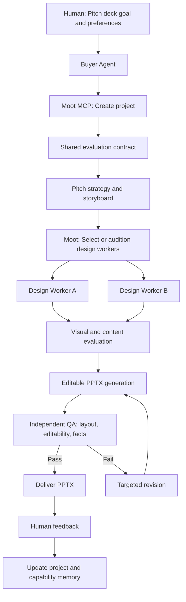

# Moot — Open-Source PPT Design Skills

**Purpose:** Candidate design, storytelling, and quality-assurance skills for Moot's agent-based pitch-deck workflow.  
**Compiled:** October 17, 2026  
**Note:** Repository features and licensing are based on the preceding research discussion; verify current README, LICENSE, dependencies, and functionality before production use.

## PPT Design Skills

| # | Skill / repository | Design focus | Proposed Moot role | Notes |
|---|---|---|---|---|
| 1 | [siril9/presentation-skill](https://github.com/siril9/presentation-skill) | Design styles, layouts, editable slides, render-based QA | Primary visual design + generation worker | Previously identified as MIT-licensed; verify license |
| 2 | [hunkim/slide-skill](https://github.com/hunkim/slide-skill) | Visual hierarchy, readability, simplicity, one idea per slide | Independent design critic | A guideline/skill, not necessarily a generation engine |
| 3 | [che626/competition-ppt-template-first-skill](https://github.com/che626/competition-ppt-template-first-skill) | Competition decks, template-first layouts, design tokens | Competition presentation specialist | Check supported formats and licensing |
| 4 | [gnipbao/knowledge-cat-ppt-skill](https://github.com/gnipbao/knowledge-cat-ppt-skill) | Story-first design, audience analysis, storyboard planning | Narrative + storyboard designer | Check rendering and editability support |
| 5 | [sunchaokun/PPT-Design-Skill](https://github.com/sunchaokun/PPT-Design-Skill) | Composition, audience-oriented design, visual revision | Alternative design worker | Verify `pptx-designer` dependencies and licensing |
| 6 | [PracticalSwan PPTX guidelines](https://github.com/PracticalSwan/agent-skills/blob/main/pptx/SKILL.md) | Typography, spacing, palettes, layout QA | Design rules + QA reference | Instructions, not an autonomous worker by itself |

## Recommended Moot Worker Stack

| Stage | Suggested skill | Output |
|---|---|---|
| Pitch strategy | [Pitch Deck Advisor](https://github.com/amaklakov-droid/pitch-deck-skill) | Narrative brief, target audience, key claims |
| Storyboard | [Knowledge Cat PPT](https://github.com/gnipbao/knowledge-cat-ppt-skill) | Approved slide-by-slide outline |
| Design candidate A | [Competition PPT Skill](https://github.com/che626/competition-ppt-template-first-skill) | Visual design proposal |
| Design candidate B | [presentation-skill](https://github.com/siril9/presentation-skill) | Alternative design proposal and editable deck |
| PPTX implementation | [pptx-gen](https://github.com/alfonsograziano/pptx-gen) | Editable PowerPoint artifact |
| Independent review | [slide-skill](https://github.com/hunkim/slide-skill) and [PracticalSwan guidelines](https://github.com/PracticalSwan/agent-skills/blob/main/pptx/SKILL.md) | Critique, validation, revision requests |

## Proposed MCP Workflow

### Example revision

> “Make slide 3 more visually compelling, but preserve the financial numbers and approved narrative.”

Moot should identify the affected slide, retrieve the approved content and design constraints, route the revision to a qualified design worker, and verify that the facts remain unchanged. The agent's capability record should reflect verified outcomes, not self-reported quality.

## Evaluation Rubric

| Dimension | Example checks | Evaluation method |
|---|---|---|
| Editability | Text and shapes remain native editable elements | Inspect PPTX structure |
| Visual layout | No clipping, overlap, or unreadable text | Render slides and inspect |
| Narrative | Each slide advances the approved pitch | Contract-based review + human feedback |
| Factual integrity | Numbers and claims unchanged unless authorized | Structured diff and source verification |
| Brand consistency | Fonts, palette, spacing, logos | Design-token checks + visual review |
| Revision quality | Requested slide changes; unaffected slides remain stable | Before/after artifact comparison |
| Efficiency | Generation latency and provider costs | Measured execution telemetry |

## MVP Priorities

1. Start with **Knowledge Cat PPT** for storyboard, **presentation-skill** for generation, and **slide-skill** for critique.
2. Add a second design candidate only when the first end-to-end workflow works.
3. Expose project creation, status, revision, and verification through MCP.
4. Keep human approvals for subjective design decisions; automate deterministic checks.
5. Track worker version, evaluation context, evidence, and cost in Moot's capability memory.

## Important Integration Caveats

- A GitHub skill can be a prompt or instruction document rather than a standalone service. Wrap it in a reproducible worker runtime before comparing candidates.
- Confirm repository licenses and commercial-use permissions before copying code or shipping dependencies.
- Run untrusted skill code in isolated environments with restricted secrets, network, and filesystem access.
- Design scores from LLM judges are subjective signals; they should not replace human approval or deterministic artifact checks.
